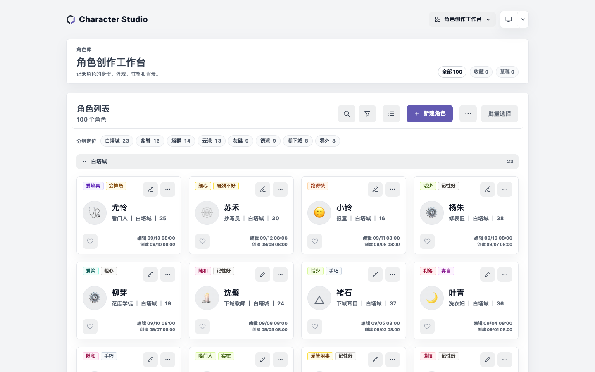
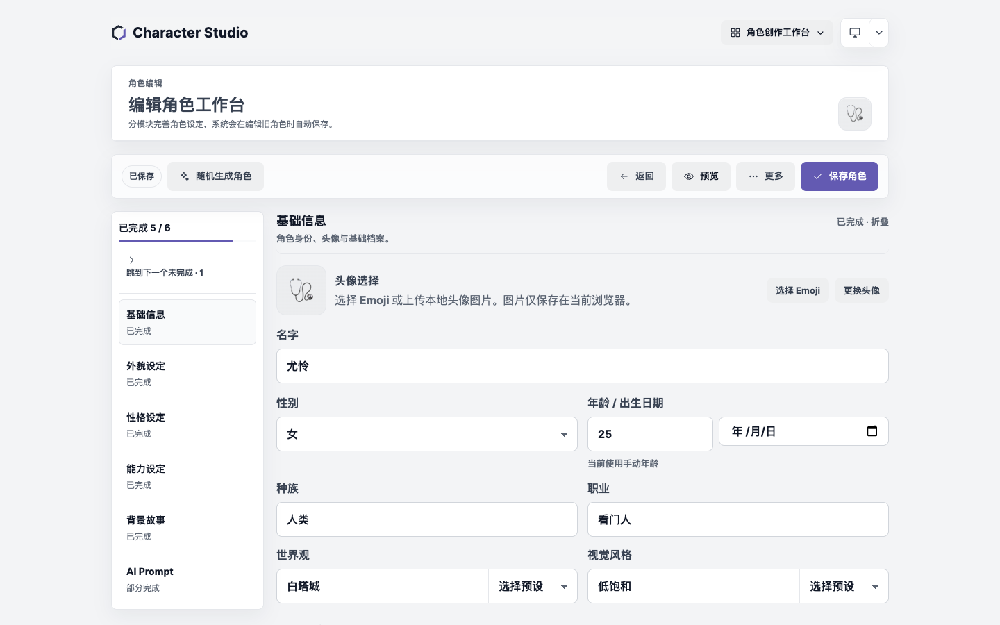
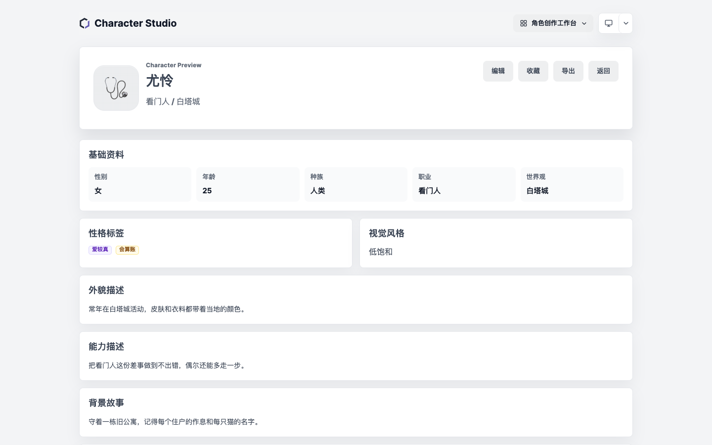
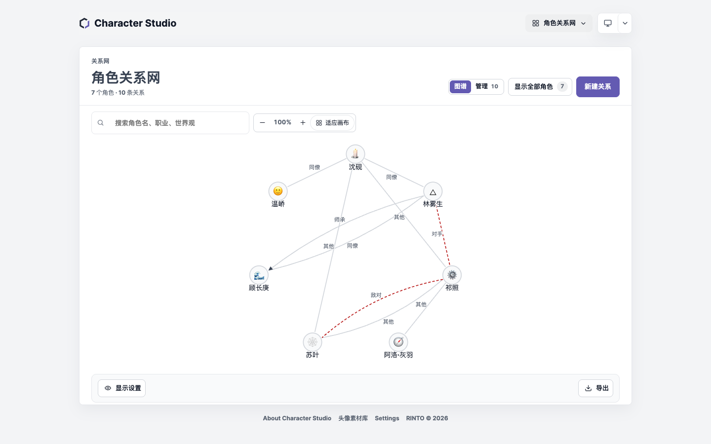
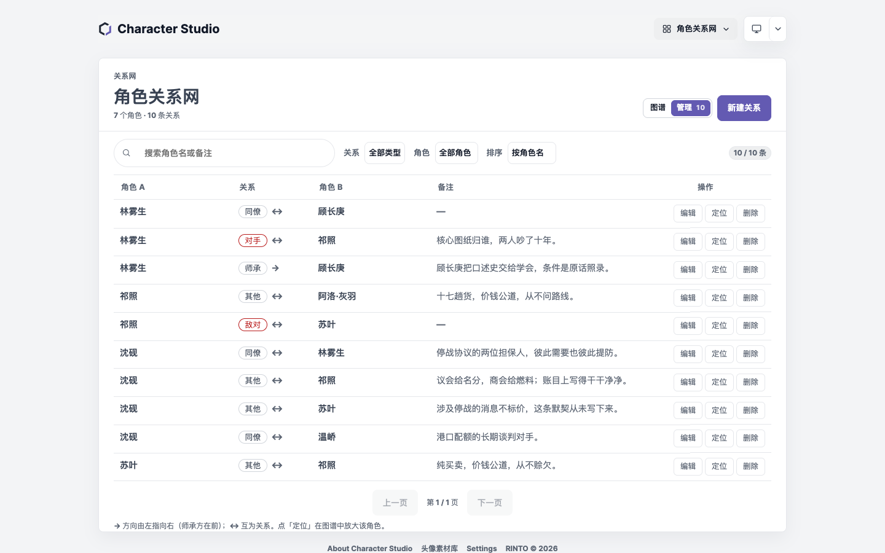
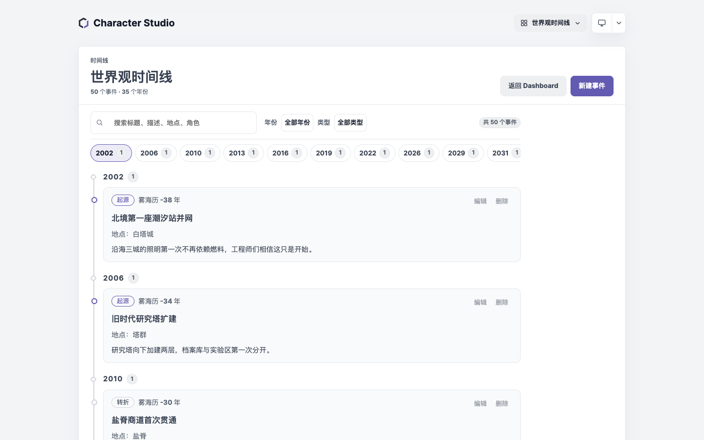
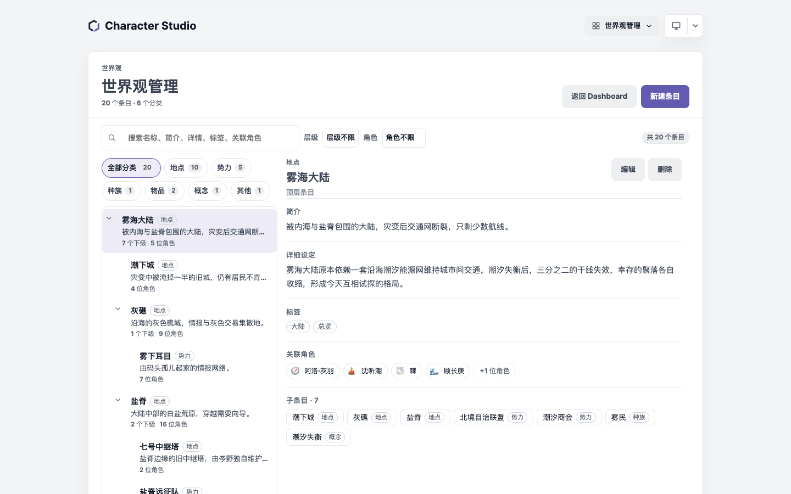
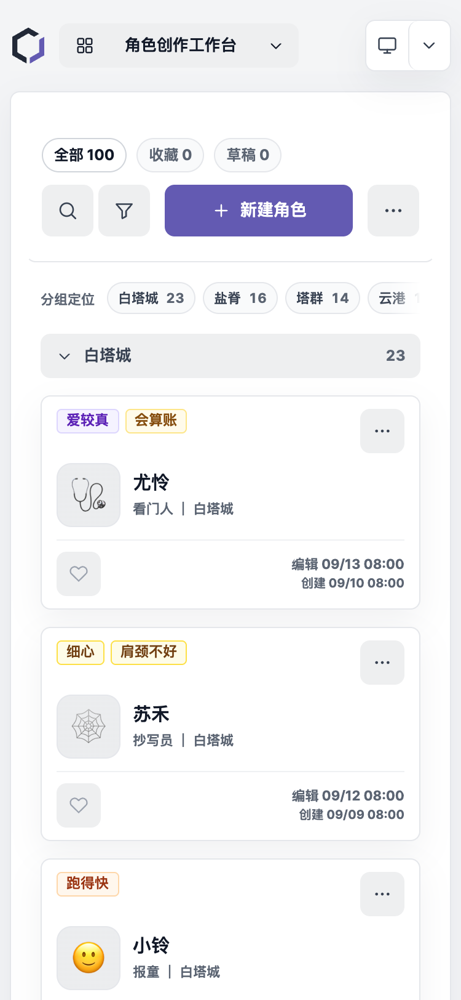
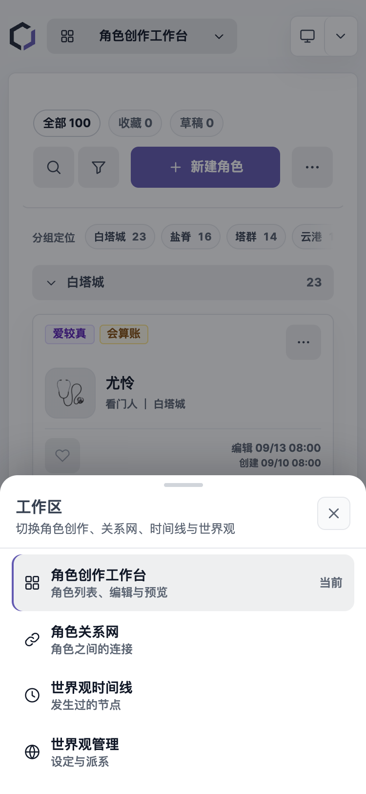

# Character Studio

> 面向 OC / 原创角色创作者的**本地优先**角色与世界观管理工作台。

[](https://github.com/RintoTan/character-studio/actions/workflows/deploy-pages.yml)


**[在线使用 →](https://rintotan.github.io/character-studio/)**　不需要注册，不连接服务器，角色资料保存在当前浏览器。

---

## 项目介绍

写 OC 的人常常同时维护三类东西：角色卡、人物关系、以及他们所处的世界。它们散落在文档、表格和聊天记录里，改一处就要同步三处；想备份，只能手动复制。

Character Studio 把这三件事放进同一个工作台：

- **角色**有一个可分节填写、可自动保存、可导出档案的编辑器；
- **关系**是一张可缩放、可搜索、可管理的图，而不是散落的备注；
- **时间线**和**世界观**各自成库，并与角色互相引用；
- 所有数据**只存在本机浏览器**，可随时导出 JSON / ZIP 备份或迁移。

主要面向小说、插画、跑团、企划和 AI 绘图 Prompt 的作者。当前版本是纯前端应用，没有账号体系，也没有云端同步。

---

## 界面预览

[[](docs/screenshots/dashboard.png)](docs/screenshots/dashboard.png)

| 角色编辑器 | 角色预览 |
| --- | --- |
| [[](docs/screenshots/character-editor.png)](docs/screenshots/character-editor.png) | [](docs/screenshots/character-preview.png) |
| **角色关系网** | **关系管理** |
| [[](docs/screenshots/relationship-graph.png)](docs/screenshots/relationship-graph.png) | [](docs/screenshots/relationship-manage.png) |
| **世界观时间线** | **世界观管理** |
| [[](docs/screenshots/timeline.png)](docs/screenshots/timeline.png) | [](docs/screenshots/world.png) |

| 手机端工作台 | 手机端导航抽屉 |
| --- | --- |
| [[](docs/screenshots/mobile-dashboard.png)](docs/screenshots/mobile-dashboard.png) | [](docs/screenshots/mobile-navigation.png) |

> 截图使用虚构测试数据（100 个角色 / 191 条关系 / 50 个事件 / 20 个世界观条目），不含任何真实用户资料。关系网一张取同一数据集中连接最密的 7 个角色，否则 191 条边在页面尺寸内无法看清标签。

---

## 核心功能

### 角色创作与管理

- 卡片与列表两种视图，可按名称、职业、世界观、性格标签搜索
- 按最近编辑 / 创建时间 / 名称排序，按世界观、性别、视觉风格筛选
- 收藏、草稿箱、置顶；批量选择、复制、删除、收藏、导出
- 删除后 10 秒内可撤销，连同被清理的关系与引用一起恢复
- 角色较多时按世界观分组，并提供分组定位条

### 角色编辑

- 六个分节：基础信息、外貌设定、性格设定、能力设定、背景故事、AI Prompt
- 完成度进度与「跳到下一个未完成」；分节折叠状态按习惯记住
- Emoji 头像、上传并裁剪头像、从本地头像素材库选择
- 本地规则生成中文关键词与英文绘图 Prompt，不调用外部模型
- **灵感工作室**：七类本地灵感库（外貌、性格、职业身份、背景、动机与冲突、兴趣与习惯、重要物品），按已填写内容关联候选，可换一批、单条重抽、组合多条并在应用前预览差异；写入只改编辑器草稿，已有内容默认追加
- 自动保存草稿、临时保存、`Ctrl / Cmd + S` 保存

### 角色预览与导出

- 同一页面有两种工具栏：浏览入口提供 `编辑 / 收藏 / 导出 / 返回`，编辑入口提供 `返回编辑 / 保存草稿 / 删除角色 / 保存角色`
- 点击头像查看大图；导出 JSON / PDF / JPG / PNG 时会排除页面按钮
- 角色档案 PDF 为**可选中、可搜索的中文文本**，而不是整页截图

### 角色关系网络

- 8 种关系：亲属、师承、友人、对手、敌对、同僚、情感、其他
- **方向有语义**：师承画箭头、读作 `A → B`；互为类不画箭头、读作 `A ↔ B`
- 重复关系在保存前拒绝并说明原因，不会静默失败
- 径向布局、缩放、拖拽平移、悬停高亮；点击节点进入该角色
- 首次进入默认显示图谱，切换后的视图偏好会被记住
- 默认只画参与关系的角色，并明确写出「已画 / 有连接 / 总数」；可一键显示全部
- 搜索任意角色可定位并聚焦，包括默认未画出的角色
- 「管理」模式提供表格：搜索双方与备注、按类型 / 角色筛选、排序、每页 20 条；编辑与删除同步回图谱
- 可导出 JPG / PNG / 截图式 PDF，分辨率 1x / 2x / 3x

### 故事时间线

- 事件包含标题、日期、可选纪年显示（如「光历 318 年」）、类型、地点、描述、关联角色
- 日期接受 `2026` / `2026-05` / `2026-05-01`；排序只依据真实日期，不依赖纪年标签
- 年份导航、按年份分组、按日期升序；支持搜索与按年份 / 类型筛选
- 事件可新建、编辑、删除，关联角色随角色库同步

### 世界观条目

- 六类：地点、势力、种族、物品、概念、其他
- 树形层级（城市隶属于国家），可折叠；删除父级时子级**脱离为顶层**，不会一起消失
- 每个条目可写简介与详细设定、打标签、关联角色
- 桌面端为「树 + 详情」双栏；手机端在列表与详情之间切换，并提供返回入口

### 跨模块关联

角色的预览页会汇总与它相关的关系、时间线事件和世界观条目；关系、事件与条目的删除或改名都会反映到相关视图。删除角色时，指向它的引用会被清理，撤销时按 **ID** 恢复。

### 数据管理与备份

- 单角色 JSON、角色库 JSON、完整备份 ZIP、头像素材 JSON、CSV 导入导出
- 完整备份包含角色、头像文件、关系、时间线、世界观
- 导入前显示预检结果（新增 / 冲突 / 缺失引用），确认后才写入
- 导入失败不会留下半套数据；写入前自动保存一份恢复快照

### 移动端

- 主工作区切换使用**底部抽屉**：四项工作区齐全、当前项明确、点选即切换
- 「更多操作」在手机上同样是抽屉，视图切换与批量管理放在其中
- 工具栏在 320 / 375 / 390 / 430px 保持单行，不隐藏「新建角色」
- 分组定位条保留横向滚动，并用边缘渐隐提示还有内容
- 关系网在手机上自动适配初始缩放；世界观与时间线按单列阅读

### 规划中（尚未实现）

以下方向**尚未实现**，仅作为路线图记录：

- 角色人生轨迹（按阶段串联事件与状态变化）
- 动态人物关系（关系随时间变化，而不只是一条当前状态）
- 世界观与故事的联动视图

---

## 数据与安全

**存储位置**

| 数据 | 位置 |
| --- | --- |
| 角色、关系、时间线、世界观、界面偏好 | `localStorage` |
| 上传的头像与头像素材（二进制） | `IndexedDB` |
| 自动恢复快照 | `localStorage`，单槽位 |

**需要理解的边界**

- 这是**浏览器本地存储**，不是云端，也不是永久备份。清除站点数据、换浏览器或换设备，本地数据不会自动跟过去。
- 唯一可靠的跨设备方式是导出 **完整备份 ZIP** 并妥善保存。
- 自动恢复快照只保留**最近一次**破坏性操作前的角色与三个工作区数据；**不包含头像二进制**。
- 撤销只在当前页面会话内有效（10 秒）。

**导入与导出**

| 格式 | 内容 | 可重新导入 |
| --- | --- | --- |
| 单角色 JSON | 一个角色的文字资料与内嵌头像 | 是 |
| 角色库 JSON | 全部角色文字资料，不含头像文件 | 是 |
| 完整备份 ZIP | 角色 + 头像 + 关系 + 时间线 + 世界观 | 是 |
| 头像素材 JSON | 素材库中的图片 | 是 |
| CSV | 角色的文字列，可在表格软件中编辑 | 是（不含头像） |
| PDF / JPG / PNG | 阅读与分享 | 否 |

**完整备份 ZIP 结构**

```text
characters.json      # { characters: Character[] }
workspace.json       # { workspaceVersion, relationships, timeline, world }
manifest.json        # 角色 → 头像文件的绑定、MIME、大小
backup-info.json     # 导出时间、数量、格式说明
assets/avatar/*      # 头像图片
```

**导入规则**

- **合并**：保留现有数据，按 ID 判断冲突；**替换**：导入包成为完整角色库。
- 冲突可选「保留现有 / 用导入替换 / 作为副本导入」；副本会获得新 ID。
- 合并时若 ID 冲突且需要保留双方，会**重映射 ID**，并同步改写关系、时间线与世界观里的引用。
- 缺失引用不会凭空补一个角色，而是在预检里列出；导入后这些引用保持缺失状态。
- 旧备份若没有 `workspace.json`，只导入角色与头像，不覆盖现有工作区数据。
- `backup-info.json` 中的 `appVersion` 是历史字段，目前固定为 `0.1.0`，不代表实际版本。

---

## 快速开始

**直接使用**：[rintotan.github.io/character-studio](https://rintotan.github.io/character-studio/)

**本地开发**（Node.js 22+，包管理器使用 pnpm）：

```bash
pnpm install
pnpm dev          # 本地开发
pnpm typecheck    # TypeScript 检查
pnpm test         # 单元测试（49 个文件 / 549 个用例）
pnpm build:pages  # 按 GitHub Pages 子路径构建
pnpm verify:browser  # 真实浏览器回归（68 项）
```

`package.json` 中的全部命令：

| 命令 | 作用 |
| --- | --- |
| `dev` | 启动 Vite 开发服务器 |
| `build` | 类型检查并按根路径构建 |
| `build:pages` | 按 `/character-studio/` 构建，并写入 `build-info.json` |
| `preview` | 预览构建结果 |
| `typecheck` | `tsc -b` |
| `test` | vitest 单元测试 |
| `verify:browser` | 通过 CDP 驱动本机 Chrome 的端到端检查 |
| `verify:version` | 校验 `version.ts` 与 `package.json` 版本一致 |
| `verify:deploy` | 校验线上产物与本地构建逐字节一致 |

---

## 技术说明

| 技术 | 用途 |
| --- | --- |
| React 18 + TypeScript 5.7 | 界面与类型约束 |
| Vite 6 | 开发与构建 |
| vitest 3 + happy-dom + fake-indexeddb | 单元测试，不需要真实浏览器 |
| jsPDF | 角色档案文本 PDF，动态加载 |
| html2canvas | 预览页与关系网的图片 / 截图式 PDF，动态加载 |
| localStorage / IndexedDB | 文字数据 / 头像二进制 |

应用没有路由库：页面由 7 个值的 `Page` 联合类型与 History API 管理；部署在 GitHub Pages 的 `/character-studio/` 子路径下。

---

## 项目结构

```text
src/
├── pages/            # Dashboard、编辑器、预览、关系网、时间线、世界观、开发者中心
├── components/       # 共享组件（底部抽屉、头像、角色选择器、工作区标题等）
├── hooks/            # 键盘、媒体查询、保存、分节、滚动提示等
├── storage/          # localStorage / IndexedDB 读写与迁移
├── utils/            # 导入导出、PDF、头像、关系布局等纯逻辑
├── types/            # Character / Relationship / Timeline / World / App
├── config/           # 版本号与开发者设置
├── assets/fonts/     # PDF 使用的中文字体子集与 OFL 许可证
└── styles.css        # 设计令牌与全部样式
test/                 # vitest 单元测试（48 个文件）
scripts/              # 构建身份、版本校验、部署校验、浏览器回归
docs/                 # 技术文档、状态、路线图、截图
.github/workflows/    # GitHub Pages 部署
```

---

## 开发与贡献

1. 改代码前先读 [docs/ARCHITECTURE.md](docs/ARCHITECTURE.md) 与 [docs/DATA_FORMATS.md](docs/DATA_FORMATS.md)。
2. 保持数据兼容：存储键与备份格式的变更必须提供迁移，不允许静默丢弃旧数据。
3. 改动后至少运行 `pnpm typecheck`、`pnpm test`；涉及布局或交互时再运行 `pnpm verify:browser`。
4. 提交信息说明「为什么」，并在 [CHANGELOG.md](CHANGELOG.md) 记录验证边界。
5. 文档入口与职责划分见 [docs/README.md](docs/README.md)。

本项目目前由个人维护，没有公开的贡献流程或行为准则；提交 Issue 前请先确认问题能在最新版本复现。

---

## 项目状态

- 当前版本：**v2.38.0**（Sprint 48）
- 阶段：核心功能已可用，处于持续迭代与移动端完善阶段
- 线上产物：由 GitHub Actions 构建并部署到 GitHub Pages
- 最近一轮：角色灵感工作室 2.0（七类本地灵感库、上下文关联、候选挑选与重抽、应用预览、安全写入草稿）与六项交互稳定性修复（返回来源栈、编辑器取消、图谱默认、浮动工具避让、长名称表格、时间线弹窗）

详细状态、已知问题与下一步见 [docs/PROJECT_STATUS.md](docs/PROJECT_STATUS.md) 与 [docs/ROADMAP.md](docs/ROADMAP.md)。

---

## 项目文档

| 文档 | 内容 |
| --- | --- |
| [docs/PROJECT_STATUS.md](docs/PROJECT_STATUS.md) | 当前版本、完成度、验证情况、已知问题摘要 |
| [docs/ARCHITECTURE.md](docs/ARCHITECTURE.md) | 路由、组件、状态域、存储与部署 |
| [docs/DATA_FORMATS.md](docs/DATA_FORMATS.md) | 角色 / 关系 / 时间线 / 世界观字段与备份格式 |
| [docs/FEATURES.md](docs/FEATURES.md) | 功能清单与实现状态 |
| [docs/TESTING.md](docs/TESTING.md) | 单元测试与浏览器回归的范围和运行方式 |
| [docs/DEPLOYMENT.md](docs/DEPLOYMENT.md) | 构建、发布、回滚与线上校验 |
| [docs/ROADMAP.md](docs/ROADMAP.md) | 近期与长期计划 |
| [CHANGELOG.md](CHANGELOG.md) | 逐版本变更与验证边界 |
| [Developer Handbook.md](Developer%20Handbook.md) | 长期开发手册（应用内也有入口） |

---

## 许可证

本仓库**没有附开源许可证文件**，因此默认保留所有权利（All rights reserved）。未经作者许可，不得复制、分发或用于商业用途。

仓库内 `src/assets/fonts/NotoSansSC-CS.ttf` 是 Noto Sans SC 的子集，按 **SIL Open Font License 1.1** 授权，许可证全文见 [src/assets/fonts/OFL.txt](src/assets/fonts/OFL.txt)。该许可只覆盖字体文件本身。

---

<sub>Character Studio · 本地优先的角色与世界观工作台 · [在线使用](https://rintotan.github.io/character-studio/)</sub>
