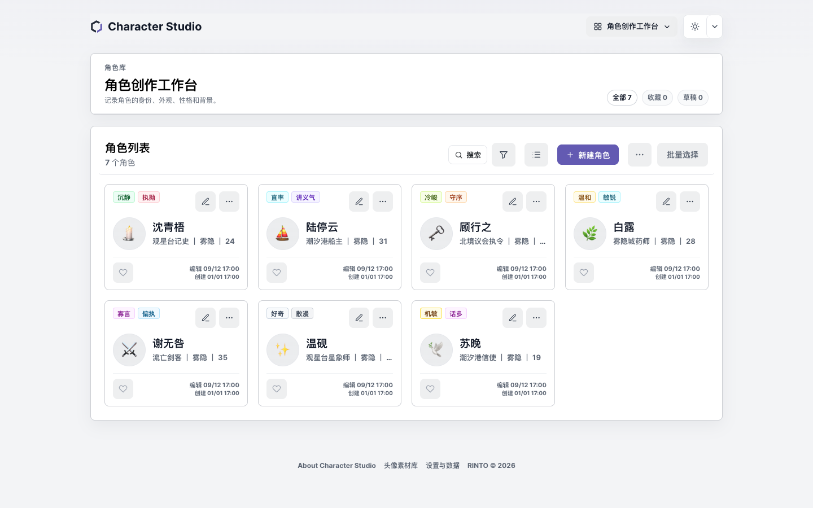
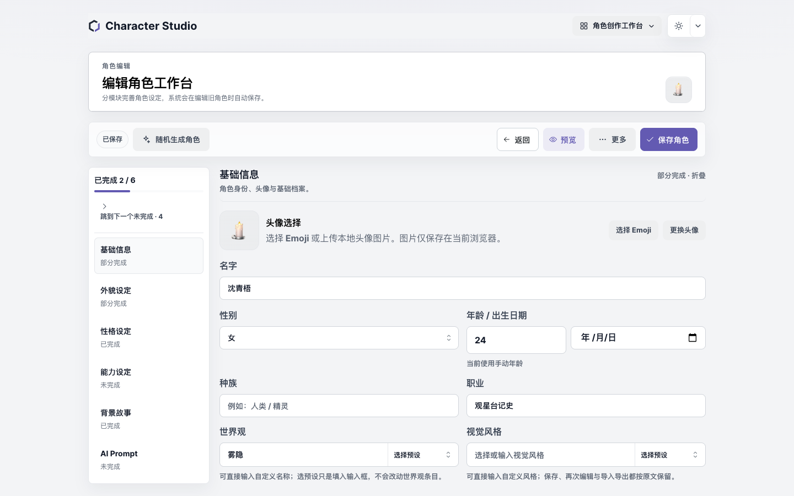
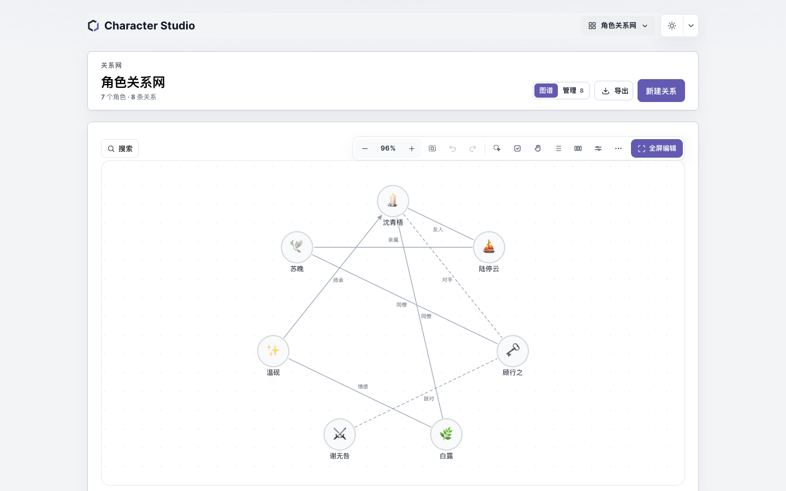
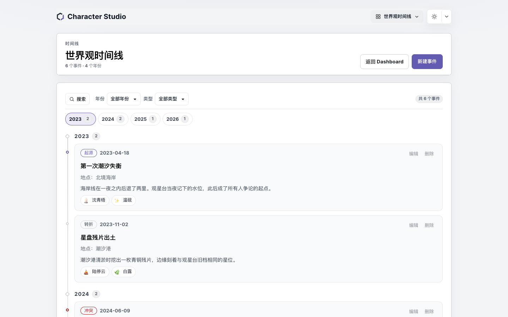
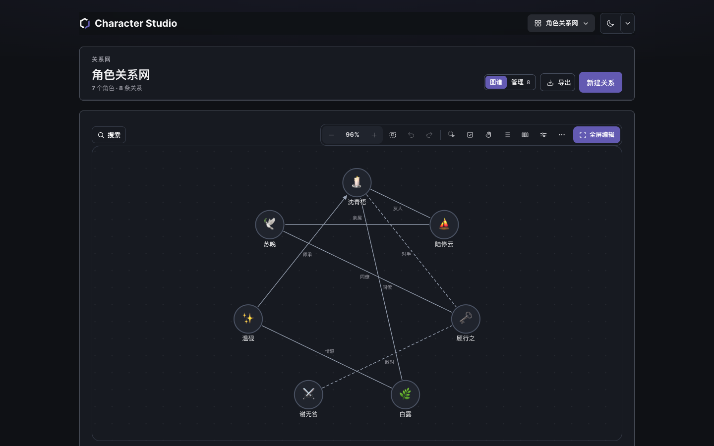

# Character Studio

> 面向 OC / 原创角色创作者的**本地优先**角色与世界观工作台。

[](https://github.com/RintoTan/character-studio/actions/workflows/deploy-pages.yml)


**[在线使用 →](https://rintotan.github.io/character-studio/)**　不需要注册，不连接服务器，资料保存在当前浏览器。



---

## 这是什么

写 OC 的人往往同时维护三类东西：角色卡、人物关系、以及他们身处的世界。它们散在文档、表格和聊天记录里，改一处要同步三处；想备份，只能手动复制。

Character Studio 把这三件事放进同一个工作台：

- **角色**有可分节填写、自动保存草稿、可导出档案的编辑器；
- **关系**是一张能缩放、能搜索、能自由摆布的画布，而不是散落的备注；
- **时间线**与**世界观**各自成库，并与角色互相引用；
- 所有数据**只存在本机浏览器**，可导出 JSON / ZIP 备份或迁移到别的设备。

面向小说、插画、跑团、企划与 AI 绘图 Prompt 的作者。当前是纯前端应用：没有账号体系，也没有云端同步。

---

## 四个模块

### 1. 角色创作

卡片与列表两种视图；按名称、职业、世界观、性格标签搜索；按世界观 / 性别 / 视觉风格筛选；收藏、草稿、批量操作；删除后 10 秒内可撤销，连同被清理的关系与引用一起恢复。

编辑器分六节（基础信息、外貌、性格、能力、背景故事、AI Prompt），带完成度进度与「跳到下一个未完成」，折叠状态按习惯记住。**灵感工作室**提供七类本地灵感库，按已填写内容给出候选，可换一批、单条重抽、组合后先预览差异再写入草稿——全部在本地规则下完成，不调用外部模型。



### 2. 关系图谱

八种关系（亲属、师承、友人、对手、敌对、同僚、情感、其他），**方向有语义**：师承画箭头、读作 `A → B`；对称关系不画箭头、读作 `A ↔ B`。重复关系在保存前拒绝并说明原因。

自由画布可以拖动节点、任意平移缩放、聚类或环形整理（先预览后提交）、多选与视觉分组；布局单独保存，随完整备份一起迁移。八个外观预设改变节点、连线与网格，选中的预设与手工微调在刷新后都保留。



### 3. 世界观时间线

事件包含标题、日期、可选纪年显示（如「雾隐纪元 41 年」）、类型、地点、描述与关联角色。日期接受 `2026` / `2026-05` / `2026-05-01`，排序只看真实日期，不依赖纪年标签。年份导航、搜索、按年份与类型筛选；长描述默认折起，需要时展开。



### 4. 世界观管理

地点、势力、种族、物品、概念、其他六类，支持树形层级（城市隶属于国家）与折叠；删除父级时子级**脱离为顶层**，不会一起消失。桌面端是「树 + 详情」双栏，手机端在列表与详情之间切换。


### 深色主题

四个工作区共用同一套设计令牌，深浅色同步切换，画布、时间线与详情页的对比度一致。



---

## 快速开始

**直接用**：[rintotan.github.io/character-studio](https://rintotan.github.io/character-studio/)

**本地开发**（Node.js 22+，包管理器 pnpm）：

```bash
pnpm install
pnpm dev          # 开发服务器
pnpm typecheck    # TypeScript 检查
pnpm test         # 单元测试
pnpm build:pages  # 按 /character-studio/ 子路径构建
```

`package.json` 里的全部命令：

| 命令 | 作用 |
| --- | --- |
| `dev` | 启动 Vite 开发服务器 |
| `build` | 类型检查并按根路径构建 |
| `build:pages` | 按 `/character-studio/` 构建并写入 `build-info.json` |
| `preview` | 预览构建结果 |
| `typecheck` | `tsc -b` |
| `test` | vitest 单元测试（95 个测试文件） |
| `verify:browser` | 用 CDP 驱动本机 Chrome 的浏览器检查（90 项，支持 `--shard=i/n` 分段） |
| `verify:version` | 校验 `version.ts` 与 `package.json` 版本一致 |
| `verify:deploy` | 校验线上产物与本地构建逐字节一致 |

---

## 数据与安全

| 数据 | 位置 |
| --- | --- |
| 角色、关系、时间线、世界观、界面偏好 | `localStorage` |
| 上传的头像与头像素材（二进制） | `IndexedDB` |
| 自动恢复快照 | `localStorage`，单槽位 |

**需要知道的边界**

- 这是**浏览器本地存储**，不是云端，也不是永久备份。清除站点数据、换浏览器或换设备，资料不会自动跟过去。
- 唯一可靠的跨设备方式是导出**完整备份 ZIP** 并妥善保存。
- 自动恢复快照只保留**最近一次**破坏性操作前的角色与三个工作区数据，**不含头像二进制**。
- 撤销只在当前页面会话内有效（10 秒）。
- 建议每次收工导出一份完整备份——浏览器清理、隐私模式、磁盘配额都可能让本地数据消失。

**导入导出**

| 格式 | 内容 | 可重新导入 |
| --- | --- | --- |
| 单角色 JSON | 一个角色的文字资料与内嵌头像 | 是 |
| 角色库 JSON | 全部角色文字资料，不含头像文件 | 是 |
| 完整备份 ZIP | 角色 + 头像 + 关系 + 时间线 + 世界观 | 是 |
| 头像素材 JSON | 素材库中的图片 | 是 |
| CSV | 角色文字列，可在表格软件里编辑 | 是（不含头像） |
| PDF / JPG / PNG | 阅读与分享 | 否 |

导入前会先显示预检结果（新增 / 冲突 / 缺失引用），确认后才写入；写入前自动保存一份恢复快照，失败不会留下半套数据。合并时若 ID 冲突需要保留双方，会重映射 ID 并同步改写关系、时间线与世界观里的引用。

---

## 技术栈

| 技术 | 用途 |
| --- | --- |
| React 18 + TypeScript 5.7 | 界面与类型约束 |
| Vite 6 | 开发与构建 |
| Mantine 7（`@mantine/core` + `@mantine/hooks`） | 编辑器输入、选择与主题基础层，样式统一收在 `src/ui/tokens.css` 的品牌令牌下 |
| vitest 3 + happy-dom + fake-indexeddb | 单元测试，不需要真实浏览器 |
| jsPDF | 角色档案文本 PDF（可选中、可搜索的中文文本） |
| html2canvas | 预览页与关系网的图片 / 截图式 PDF，动态加载 |
| localStorage / IndexedDB | 文字数据 / 头像二进制 |

没有路由库：页面由 `Page` 联合类型与 History API 管理；部署在 GitHub Pages 的 `/character-studio/` 子路径下。

---

## 项目结构

```text
src/
├── pages/            # Dashboard、编辑器、预览、关系网、时间线、世界观、开发者中心
├── components/       # 共享组件（底部抽屉、头像、角色选择器、工作区标题等）
├── ui/               # Mantine 封装（EditorSelect 等）与设计令牌
├── hooks/            # 键盘、媒体查询、保存、分节、滚动提示等
├── storage/          # localStorage / IndexedDB 读写、迁移与备份
├── utils/            # 导入导出、PDF、头像、关系布局等纯逻辑
├── types/            # Character / Relationship / Timeline / World / App
├── config/           # 版本号与开发者设置
├── assets/fonts/     # PDF 使用的中文字体子集与 OFL 许可证
└── styles.css        # 设计令牌与全部样式
test/                 # vitest 单元测试（95 个文件）
scripts/              # 构建身份、版本校验、部署校验、浏览器检查与分段汇总
docs/                 # 技术文档、状态、路线图、截图
.github/workflows/    # GitHub Pages 部署
```

---

## 开发与贡献

1. 改代码前先读 [docs/ARCHITECTURE.md](docs/ARCHITECTURE.md) 与 [docs/DATA_FORMATS.md](docs/DATA_FORMATS.md)。
2. 保持数据兼容：存储键与备份格式的变更必须提供迁移，不允许静默丢弃旧数据。
3. 日常小改动跑相关单元测试 + `pnpm typecheck`；涉及布局或交互时再运行受影响的那几项浏览器检查（`pnpm verify:browser --only=<关键词>`），完整套件不是每次修改的默认要求。
4. 提交信息说明「为什么」，并在 [CHANGELOG.md](CHANGELOG.md) 记录验证边界。
5. 文档入口与职责划分见 [docs/README.md](docs/README.md)。

本项目目前由个人维护，没有公开的贡献流程或行为准则；提交 Issue 前请先确认问题能在最新版本复现。

---

## 项目状态

- 当前版本：**v2.60.0**
- 阶段：Mantine UI 收尾完成，进入发布候选（候选分支尚未合并至 `main`）
- 已知边界：浏览器验收的完整套件并非每次发布都全量执行，详见 [docs/TESTING.md](docs/TESTING.md)；移动端工具栏与首屏密度仍在收敛，详见 [docs/KNOWN_ISSUES.md](docs/KNOWN_ISSUES.md)

详细状态、已知问题与下一步见 [docs/PROJECT_STATUS.md](docs/PROJECT_STATUS.md) 与 [docs/ROADMAP.md](docs/ROADMAP.md)。

---

## 项目文档

| 文档 | 内容 |
| --- | --- |
| [docs/PROJECT_STATUS.md](docs/PROJECT_STATUS.md) | 当前版本、完成度、验证情况、已知问题摘要 |
| [docs/ARCHITECTURE.md](docs/ARCHITECTURE.md) | 路由、组件、状态域、Mantine 主题层、存储与部署 |
| [docs/DATA_FORMATS.md](docs/DATA_FORMATS.md) | 角色 / 关系 / 时间线 / 世界观字段与备份格式 |
| [docs/FEATURES.md](docs/FEATURES.md) | 功能清单与实现状态 |
| [docs/TESTING.md](docs/TESTING.md) | 单元测试与浏览器检查的范围和运行方式 |
| [docs/ACCEPTANCE.md](docs/ACCEPTANCE.md) | 验收分层、截图索引与回归入口 |
| [docs/DEPLOYMENT.md](docs/DEPLOYMENT.md) | 构建、发布、回滚与线上校验 |
| [docs/ROADMAP.md](docs/ROADMAP.md) | 近期与长期计划 |
| [docs/KNOWN_ISSUES.md](docs/KNOWN_ISSUES.md) | 已知问题与验证边界 |
| [CHANGELOG.md](CHANGELOG.md) | 逐版本变更与验证边界 |
| [Developer Handbook.md](Developer%20Handbook.md) | 长期开发手册（应用内也有入口） |

---

## 许可证

本仓库**没有附开源许可证文件**，因此默认保留所有权利（All rights reserved）。未经作者许可，不得复制、分发或用于商业用途。

仓库内 `src/assets/fonts/NotoSansSC-CS.ttf` 是 Noto Sans SC 的子集，按 **SIL Open Font License 1.1** 授权，许可证全文见 [src/assets/fonts/OFL.txt](src/assets/fonts/OFL.txt)。该许可只覆盖字体文件本身。

---

<sub>Character Studio · 本地优先的角色与世界观工作台 · [在线使用](https://rintotan.github.io/character-studio/)</sub>
